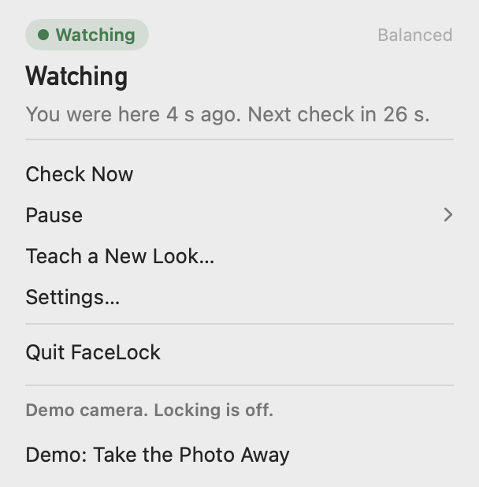
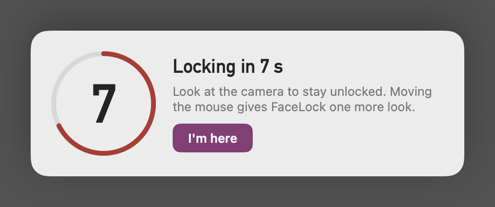
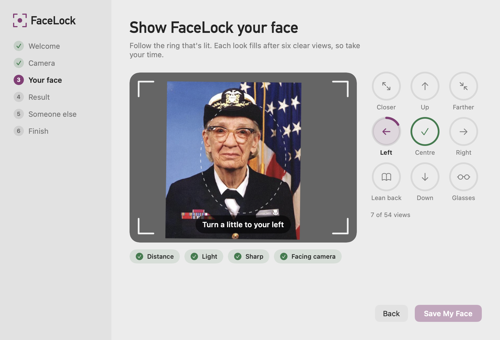
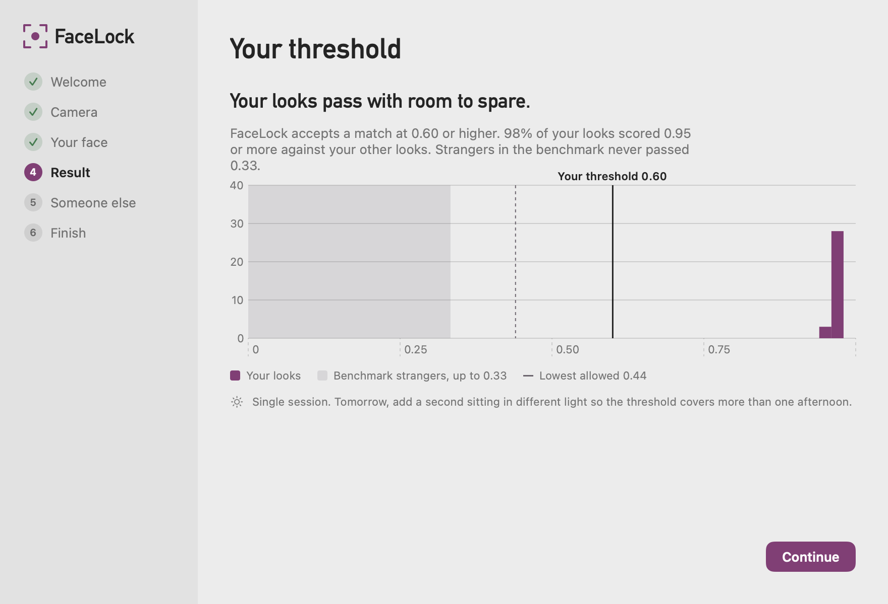
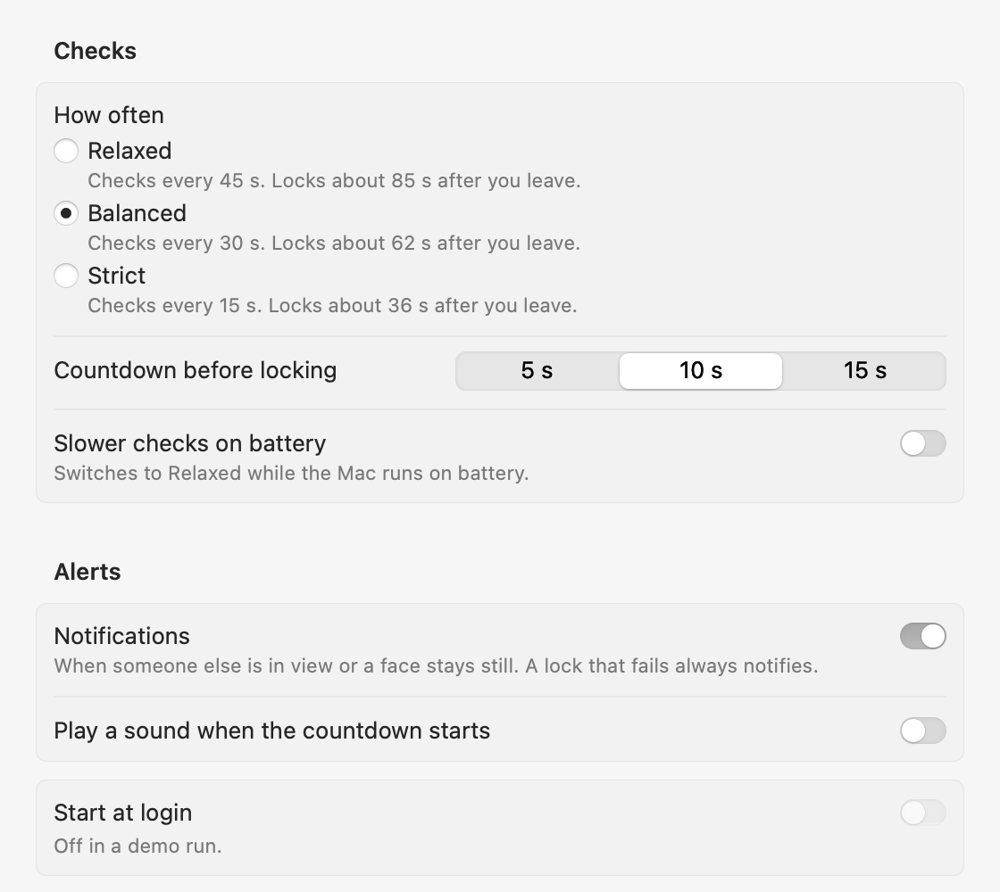

# FaceLock

Locks your Mac when you walk away. It checks for your face with the webcam every 30 seconds, entirely on this Mac.

FaceLock is not a login and cannot tell a video of you from you. It notices a face that stays perfectly still for minutes, such as a propped-up photo, and asks you to turn your head before staying unlocked.

<p>


</p>

## How it works

FaceLock lives in the menu bar. At each check it turns the camera on, looks for your face, and turns the camera off at the first frame that shows you. When it can't find you, it looks again twice with the camera off in between, then puts up a 10 second countdown with the camera on. Your face stops the countdown. A key press, a mouse move or "I'm here" only buys one more look: the panel says "Checking for you…", and if that look doesn't see you the Mac locks with no second countdown. Someone at your keyboard can delay a lock once and can't cancel it indefinitely.

| Preset | Checks every | Rechecks after a miss | Locks after you leave, at most |
|---|---|---|---|
| Relaxed | 45 s | 15 s, then 7.5 s | 85 s |
| Balanced (default) | 30 s | 10 s, then 5 s | 62 s |
| Strict | 15 s | 6 s | 36 s |

The worst case counts a full interval, every recheck at its longest and a 10 s countdown, plus the time the camera takes to send its first frame. On the demo camera, a Balanced run locked about 53 s after the photo left.

Each look runs two models on the Neural Engine: YuNet finds faces and five landmarks, and ArcFace r50 turns an aligned crop into 512 numbers that are compared with your enrolled looks. A face that is too small, tilted, turned away, cut off, dark or blurry is "unclear", never "stranger", and follows the same cadence as an empty room, so a badly posed owner is never locked faster than an absent one. Only a clear face that scores like nobody you know, in 2 frames of one check, gets the faster recheck.

A camera that sends no frame (lid closed, unplugged, suspended, failing) is never taken for an empty room: that check is retried with backoff, can never lead to a lock, and after two in a row the menu says "Not protecting: the camera isn't responding" while FaceLock rebuilds its camera session. Nothing runs while the screen is locked, the display or the Mac is asleep, or FaceLock is paused, and nothing polls. When the display wakes, a check runs at once.

The menu bar icon carries the state in its shape:


Every rule, with the numbers behind it: [docs/how-it-decides.md](docs/how-it-decides.md).

## Install

You need macOS 15 or later on Apple silicon, and a camera (built in, or an external webcam).

There is no public download: the recognizer's weights are licensed for non-commercial research only, so a public DMG would redistribute them (see [Licences](#licences)). Build the app yourself (see [Build from source](#build-from-source)), or, with a Developer ID, make a notarized disk image with `scripts/notarize.sh`.

1. Open `FaceLock.dmg` and drag FaceLock into Applications, or copy `build/FaceLock.app` there (`scripts/build-app.sh --install` does it). Run it from Applications: macOS refuses Start at login for an app run from Downloads or from the disk image.
2. Open FaceLock. The setup window appears, and macOS asks once for the camera.
3. On the last step, choose **Allow Notifications**, so a lock that fails can reach you, and turn on **Start at login**. If macOS says the login item needs approval, approve it in System Settings > General > Login Items.

## Setup

The first launch opens a setup window, and nothing needs a terminal.

1. **Welcome.** What FaceLock does and doesn't do, and what stays on the Mac.
2. **Old version.** Only if the Python FaceLock is installed: quit it, remove its login item and launcher, import its settings. Everything removed goes to the Trash.
3. **Camera.** One permission prompt. If access is off, a button opens the right pane of System Settings.
4. **Your face.** Nine looks, each placed where your head goes, with live checks for distance, light, sharpness and facing the camera. A look fills after six clear views at least 250 ms apart, at your pace.
5. **Result.** Your scores drawn against the strangers in the benchmark, the threshold FaceLock chose, and which looks, if any, come close to strangers.
6. **Someone else**, optional. A second person looks at the camera for 10 s, and if they score close to you, your threshold rises. Only their best score is kept.
7. **Finish.** Notifications and Start at login, each showing what macOS actually allows.





The day after setup, the menu offers **Add today's light**: 20 seconds in different light, so your threshold isn't tuned to one afternoon. **Teach a new look** (after a haircut or new glasses) asks for Touch ID or your password first.

## Numbers

Before is the Python version (0.4, YuNet and MobileFaceNet on ONNX Runtime). After is this build, measured on 2026-10-18 on an Apple M5 Pro running macOS 27.0.1, with other jobs running: every result in `bench/results/2026-10-18-apple-m5-pro.json` carries the load average it saw.

| | Before: Python 0.4 | After: FaceLock 0.5.1 | Target |
|---|---|---|---|
| One frame, camera path (640x480 to a decision) | 8.5 ms | 1.89 ms mean, 1.96 ms p95 (load 4.3) | 2.5 ms p95 |
| CPU per frame, camera path | about 107 mJ | 1.05 ms, 4.1 mJ | |
| A look after 30 s of idle, engine only (3 frames) | 320 mJ | 13.5 ms of CPU, 39 mJ (median of 5) | 10 ms, 15 mJ |
| The app, per present check (1 frame) | not measured | 7.2 to 13.6 ms of CPU, 19 to 38 mJ | 10 ms, 15 mJ |
| The app while watching | 0.98% of a core, 40.8 J an hour | 0.032 to 0.052% of a core, 2.7 to 4.8 J an hour | 0.05%, 4 J an hour |
| Memory while watching | about 250 MB resident | 31 MB footprint (phys_footprint); resident 16 to 31 MB median, 93 MB at most | 60 MB |
| Screen locked (engine) | 0.65% of a core, 16.1 J an hour | 0.0004% of a core, 0.04 J an hour | 0.01%, 0.5 J an hour |
| Strangers on LFW: highest score, p99 | 0.3753, 0.2493 | 0.3330, 0.2227 | |
| Owners on LFW: 5th percentile | 0.6519 | 0.7234 | |
| Camera on per check | 2.04 s | not measured on hardware yet | 0.6 s median |

The app's three runs differ mostly in memory pressure. With no paging it used 0.032% of a core and 7.2 ms of CPU a check. In the two runs `scripts/bench.sh` made, with swap nearly full (17.4 of 18.4 GB) and 600 to 700 page-ins each, it used 0.045 and 0.052% of a core and 11 to 14 ms a check, almost all of it the kernel paging Core ML's memory back in: FaceLock's own code takes under 2 ms a check. So the idle target is met only without heavy paging, and the per-check targets (10 ms, 15 mJ) are not met yet.

In this round the app's cost per check fell from 18.7 ms and 52.6 mJ to 7.2 ms and 18.9 mJ (`bench/results/2026-10-18-app-menubar-redraw.json`). Time Profiler showed that each watcher state change redrew the menu bar icon, about 9 ms on the main thread every time, even when the icon looked the same. The icon now redraws only when its shape changes.

The latency target holds on a lightly loaded machine: the audit before this release measured 4.8 to 5.6 ms mean on the same path at load averages of 5 to 11. The engine-only idle figure also moves with load (0.039% and 0.024% of a core in two 600 s runs here; target 0.05%). The camera's own on-time needs a real camera and the app's permission: run Settings > Diagnostics > Measure Camera Timing. Webcam strangers and your own scores across days are not measured at scale. LFW strangers are news photos and score lower than a stranger at your own webcam would.

Reproduce everything:

```sh
bench/lfw.sh                  # LFW funneled into bench/data (figshare 5976015, sha256 checked)
scripts/build-app.sh          # build/FaceLock.app, which the app runs measure
scripts/bench.sh              # about 45 minutes; IDLE_SECONDS, LOCKED_SECONDS, APP_SECONDS shorten it
```

Single measurements: `.build/release/facelock-bench latency --lfw bench/data/lfw_funneled`, `... idle --seconds 600 --state present`, `... app --seconds 300` (the shipping app on the demo camera, sampled from outside). Method and every table: [docs/benchmarks.md](docs/benchmarks.md).

## Privacy

Nothing leaves the Mac and no camera frame is saved. FaceLock keeps two files:

- `~/Library/Application Support/FaceLock/enrollment.v2`: your face templates (lists of 512 numbers, not pictures) and your thresholds with their history, encrypted with AES-GCM. The key is in your login keychain, which FaceLock reads without a prompt while you're logged in. File mode 0600, and Time Machine skips it.
- `~/Library/Logs/FaceLock/checks.jsonl`: one line per check with camera time, frame size, scores, quality flags and the verdict. No images and no templates. Rotated at 5 MB; no line is kept longer than 30 days.

macOS does not keep login keychain items to one Mac, so Migration Assistant can carry the key and the enrollment to a new Mac. Settings > Privacy shows a weekly summary (locks, countdowns you stopped, failed locks, camera time), shows the log in Finder, and has **Delete All FaceLock Data**, which moves both files to the Trash and removes the key. Files in the Trash stay readable until you empty it. Details: [docs/privacy.md](docs/privacy.md).

## Settings

| Pane | What's there |
|---|---|
| General | How often to check (with the longest time to lock for each preset), countdown length (5, 10 or 15 s), slower checks on battery, notifications (and whether macOS allows them), sound, start at login |
| Detection | Your threshold report, Recalibrate, Check with Someone Else, Teach a New Look, learned looks and Reset, lock when someone else is looking, the still-face check (Off, Observe, On) |
| Privacy | What is stored and where, the last 7 days, show or delete the log, delete everything |
| Diagnostics | Where each model runs (Neural Engine or CPU), whether the lock call is present (never called there), Measure Camera Timing |



## Limits

- Photos and video: FaceLock is a walk-away lock, not a login. A video of you, or a photo held up and moved, keeps it unlocked. The still-face check only catches a face that stays perfectly still for minutes, and it ships in observe mode.
- Strangers at your own webcam score higher than the LFW strangers the floor comes from, and nobody has measured by how much. Use Check with Someone Else. Siblings and twins can score like you.
- In low light more checks come back unclear, so a countdown is more likely while you are there.
- One camera at a time. With the lid closed and no external camera, FaceLock waits, and the menu says so.
- FaceLock locks with a private macOS call (`SACLockScreenImmediate`), which a Developer ID app may use and the App Store does not allow. If the lock fails it puts the display to sleep, which locks only when a password is required immediately after sleep, and always notifies you.
- Camera on-time and battery cost on real hardware are not measured yet; the numbers above come from the stored-image camera.

## Build from source

```sh
python3.12 -m venv .venv-tools && .venv-tools/bin/pip install -r tools/requirements.lock.txt
.venv-tools/bin/python -I tools/convert_models.py   # models/*.mlpackage and .mlmodelc from pinned upstream files
swift test                     # Vision tests skip with a message when models/ is absent
scripts/build-app.sh           # build/FaceLock.app, signed with your Developer ID when you have one; --install copies it to /Applications
scripts/notarize.sh            # build/FaceLock.dmg, notarized and stapled (see the top of the script)
scripts/screenshots.sh         # the images on this page, from the demo camera only
scripts/install-hooks.sh       # once per clone: a pre-commit hook that refuses face data, models, logs and stray images
```

`tools/requirements.lock.txt` pins the conversion environment (Python 3.12, torch, coremltools 9.0) and `tools/models.lock.json` pins the upstream model files by sha256. The Python version is kept at the tag `python-0.4.0`.

| Module | What it does |
|---|---|
| `FaceLock` | The menu bar app: setup, the countdown panel, Settings, Teach, migration from the Python version |
| `FaceLockCore` | The watcher state machine, cadence presets, verdict rules, scoring, calibration, learning safeguards, the still-face check, the encrypted store, the log. No AppKit or AVFoundation |
| `FaceLockVision` | YuNet and ArcFace r50 on Core ML, the vImage scale, crop and warp, crop light and sharpness |
| `FaceLockCapture` | The camera session and its availability, the exposure-settle gate and frame pacing, the stored-image camera |
| `FaceLockSystem` | The lock with confirmation, session state, idle time, sleep and wake, the login item, notifications, Touch ID, the keychain |
| `facelock-bench` | The benchmark harness, including `app`, which measures the shipping app |

## Try it without a camera

After `scripts/build-app.sh`:

```sh
build/FaceLock.app/Contents/MacOS/FaceLock --demo-camera Tests/Fixtures/grace_hopper.jpg --demo-enrolled
```

The demo camera shows a stored public-domain photo, never locks, and keeps its files in a temporary folder with its key in memory. The menu gets "Take the Photo Away" to walk through the rechecks and the countdown. `--dry-run` instead watches with your real camera and enrollment and logs the lock instead of locking. `--data-dir <folder>` keeps a run's enrollment and log in that folder, with a key of its own.

## Licences

The code is MIT licensed ([LICENSE](LICENSE)). YuNet is MIT (opencv_zoo). The InsightFace r50 weights are for non-commercial research only: the repository holds no weights, but the app and the DMG bundle them, so a personal copy is fine and publishing a DMG redistributes them.
