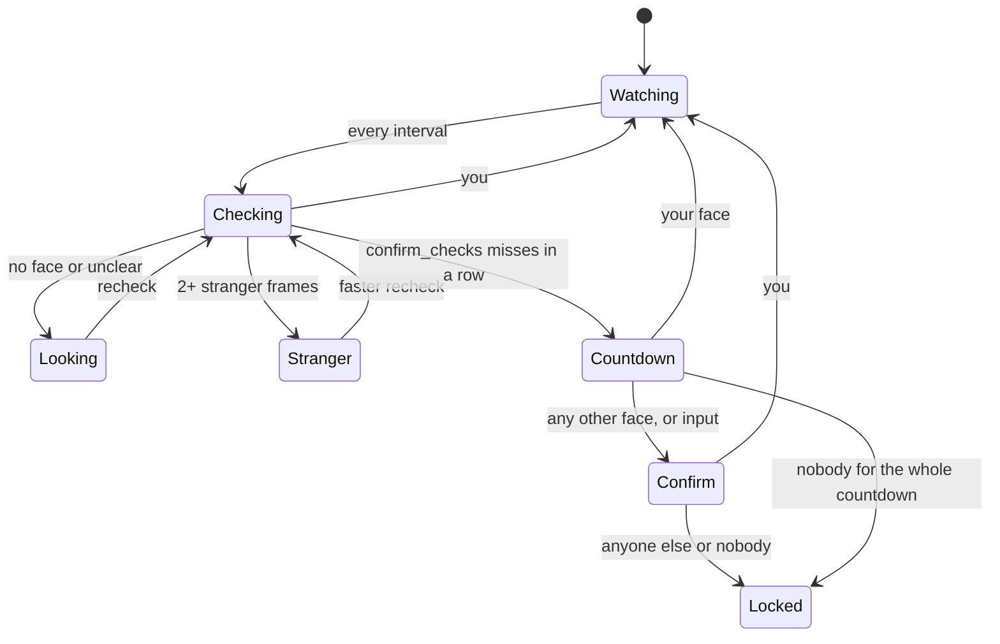

# How FaceLock decides

FaceLock is a walk-away lock. It never unlocks anything. Every check turns the camera on, looks for your face, and turns the camera off again. This page describes the rules the engine (`Sources/FaceLockCore`) follows. The numbers are provisional where marked: they come from LFW stand-ins, not from your own face.

## One check

A check is a camera window:

1. The camera starts. Frames are thrown away until exposure and white balance stop adjusting and the picture is bright enough (mean luma at least 40), for at most 0.6 s after the first frame arrives.
2. Frames are then processed no closer than 100 ms apart.
3. The first frame that shows you ends the window at once and the camera stops.
4. Otherwise the window ends after 1.5 s of settled frames or 6 processed frames (2.0 s for a recheck).

The settle cap and the window length count from the camera's first frame, so a camera that is slow to open never shortens the look. FaceLock asks the camera for 640x480. If a camera sends another shape anyway (16:9, say), the middle 4:3 of the frame is used, never a stretched frame, so your face has the proportions it was enrolled with. The frame size goes into the log.

Each processed frame runs YuNet (face boxes and five points), a quality gate, alignment to the ArcFace template, and ArcFace r50, all on the Neural Engine.

## When the camera fails

A window whose camera sends no frame within 3 s, or whose every frame fails analysis, says nothing about you. It is logged as `camera_failed`, counts as neither a miss nor an empty room, and can never lead to a countdown or a lock. The check is retried after 2.5 s, then 5, 10, 20, 40 and every 60 s. After two in a row the menu says "Not protecting: the camera isn't responding", and FaceLock rebuilds its camera session (again every third failure after that). A rebuilt session counts as working only once it has delivered a frame.

The camera FaceLock watches with is the built-in one, or any other connected camera when the built-in one is suspended (lid closed). Its own connection and suspension decide whether it is available; audio devices coming and going (AirPods) change nothing. A camera that is unplugged and plugged back in gets a new session, since the old one's input is dead.

## What a frame can say

| Verdict | Rule |
|---|---|
| You | Quality passes, the score against all your looks is at least T, and the score against your enrollment looks alone is at least F |
| Stranger | Exactly one face, quality passes, score at most S = 0.25 |
| Unclear | Anything else: a score between S and T, a face that fails the quality gate, or several faces and none of them you |
| No face | Nothing detected |

The score is the mean cosine of the 3 closest stored looks. A face that fails the quality gate (too small, tilted, turned, cut off, dark, blurry) is never a stranger, only unclear.

A window is "stranger" only when at least 2 of its frames are stranger frames. Only that verdict gets the faster recheck. An unclear window follows the same cadence as an empty room, so a badly posed owner is never locked faster than an absent one.

## From missing to locked

| Preset | Interval | Rechecks | Stranger recheck | Misses before countdown | Worst case after you leave |
|---|---|---|---|---|---|
| Relaxed | 45 s | 15 s, 7.5 s | 8 s | 3 | 85 s |
| Balanced | 30 s | 10 s, 5 s | 5 s | 3 | 62 s |
| Strict | 15 s | 6 s | 2 s | 2 | 36 s |

The worst case adds a full interval, every recheck, every window at its time cap, and a 10 s countdown; the time the camera takes to open its first frame comes on top of each window. With a camera that delivers frames at normal speed the windows end after 6 frames, and a Balanced run in `facelock-bench dry-run --leave-after 5` locked 54 s after the scene emptied.

The countdown keeps the camera on at about 4 frames a second. Your face cancels it. Any other face, a key press, a mouse move or "I'm here" also stops it, but only to take one more full look: the panel says "Checking for you…", and if that check does not see you, the Mac locks with no second countdown. Someone at the keyboard can delay a lock once and cannot cancel it indefinitely. Every cancel is logged with its cause.

If the lock call fails, FaceLock puts the display to sleep, posts a notification (always, even with notifications turned off in Settings) and goes on looking for you: the menu says "Lock failed. Looking for you", never "Watching".

Nothing runs while the screen is locked, the display or the Mac is asleep, the camera is unavailable, or FaceLock is paused. These come from system notifications; nothing polls. When the display or the Mac wakes, a check runs at once, so whoever wakes an unattended Mac starts the normal miss and countdown sequence straight away instead of a full interval later.

## Pauses

Pause for 15 minutes, 1 hour, until you unlock, or until tomorrow morning (the next 6:00 AM). Timed pauses run on the wall clock, so one that ends while the Mac sleeps is over when it wakes. "Until I unlock" ends at the next unlock and does not survive a restart or a logout: FaceLock starts after you log in, so the unlock it waited for has already happened.

## Thresholds

- **F, the floor (0.44).** The highest top-3 stranger score over all 5 LFW stand-in owners (0.3330) plus 0.10, rounded up to 0.01. `facelock-bench accuracy` derives it again; recompute and commit it whenever the model, detector or alignment changes.
- **T, your threshold.** Each enrollment look is scored against your looks from other poses or sessions, never against one captured within 2 s of it or in the same pose segment. T is the 2nd percentile of those scores minus 0.05, kept between F and C = 0.60. When T falls to F, the calibration report names the looks that score close to strangers and offers "Teach a new look".
- **Check with someone else.** A second person in front of the camera for 10 s. If their best score comes within 0.05 of T, T rises to that score plus 0.05, capped at C. Their face stays in memory only.

T, F and S live in the encrypted enrollment store with their history. Recalibration runs after each Teach, after each batch of learned looks, and from Settings.

## Learning new looks

Learned looks go to a separate pool of at most 120, each kept 60 days. A frame joins only if all of these hold: quality passes with exactly one face; its score against your enrollment looks alone is at least T; it differs from every learned look (cosine below 0.92); no stranger or unclear window happened since you last unlocked; you used the keyboard or mouse in the last 60 s; and no other look was learned in the last 10 minutes or 12 in the last day. A decision always also needs F against your enrollment looks alone, so learned looks can never carry a stranger. The harness replays each LFW stand-in owner with learning on and fails if any stranger then reaches F - 0.05.

## Someone looking over your shoulder

When you and another face big enough to read the screen (eyes at least 28 px apart) appear in 2 checks in a row, the menu bar says "Someone else is in view" and a notification is posted. "Lock when someone else is looking" is off by default. Nothing is learned while a second face is present.

## Photos and video

FaceLock is not a login and cannot tell a video of you from you. It notices a face that stays perfectly still for minutes, such as a propped-up photo, and asks you to turn your head before staying unlocked.

The still-face check flags 6 present checks over at least 3 minutes whose five points move less than 1.5 px RMS and whose size changes less than 1%. It ships in observe mode: flags are logged and nothing locks. In "On" mode a flag starts a "Turn your head" panel: the nose-to-eyes offset must change by 0.15 within 8 s, or the Mac locks.
